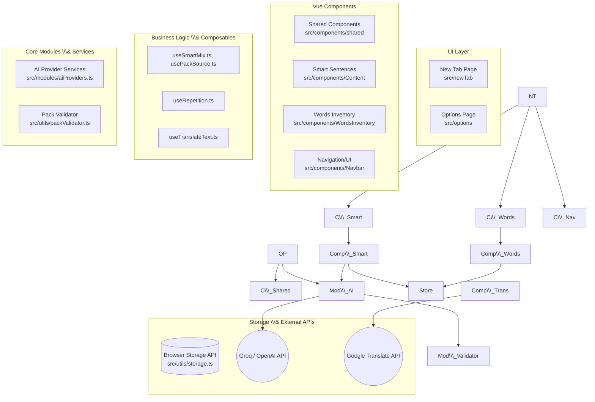

# Архитектурная карта проекта LingoTab

## 1\. Обзор проекта (Project Overview)

**LingoTab** — это браузерное расширение (версия 2.7.0), которое превращает стандартную "Новую вкладку" (New Tab) браузера в интерактивный инструмент для изучения английского языка.

**Главное назначение:** Замещение пустой новой вкладки полезным образовательным контентом, мотивирующим пользователя регулярно практиковать английский язык небольшими порциями (microlearning).

**Ключевая проблема, которую он решает:** Прокрастинация и нехватка времени на изучение языка. Помещая образовательный процесс в новую вкладку, расширение интегрирует обучение в ежедневный серфинг в интернете, делая его ненавязчивым и постоянным.

## 2\. Основной функционал (Core Features)

Функционал проекта полностью соответствует заявленным возможностям в документации (README.md), предоставляя комплексный инструмент для изучения языка:

* **Кастомизированная Новая вкладка (New Tab):** Основной UI расширения, который отображается при каждом открытии новой вкладки.
* **Инвентарь слов (Words Inventory) и Списки слов:** Модуль для управления словарным запасом. Включает базы слов (>10,000 слов из GMAT, GRE, TOEFL и др.) и позволяет сохранять в избранное (Favorites). Реализован в `src/components/WordsInventory`.
* **Поиск, Импорт и Экспорт:** Возможность искать новые слова и управлять своим прогрессом через загрузку/выгрузку данных словарного запаса.
* **Значения, Примеры и Переводы:** Интеграция сторонних API для определений и Google Translate API (`src/composables/useTranslateText.ts`) для быстрого перевода.
* **Произношение (Аудио):** Озвучивание правильного произношения изучаемых слов (логика в `src/modules/audio.ts`).
* **Режим интервального повторения:** Тренировочные сессии для возвращения к изученным словам, заложенные в алгоритме `src/composables/useRepetition.ts`.
* **Smart Sentences (Умные предложения):** Механика ИИ-предложений для практики грамматики и перевода. Поддерживает три источника данных (`packSource`), управляемых через `src/composables/smartSentences/usePackSource.ts`:

  1. **Built-in:** Встроенный базовый набор. С версии 2.7.2 существует в 10 вариантах перевода (`src/data/smartSentences/builtInPack.ts` — русский по умолчанию, плюс `builtInPack.<код>.ts` для uk/ja/zh-CN/hi/ar/fr/de/pl/es). Нужный вариант подбирается автоматически по коду языка, выбранному в настройке "Google Translate" (`src/composables/useGoogleTranslate.ts`), через словарь-подборщик `src/data/smartSentences/builtInPacks.ts` (`getBuiltInPackForLanguage`). Если для выбранного языка перевода нет — используется русский вариант по умолчанию. Английский текст предложений и вариантов ответа одинаков во всех файлах — переводу подлежат только поле `translation` и `hint.options[].explanation`.
  2. **Uploaded:** Пользовательские импортированные JSON-файлы.
  3. **AI-generated:** Динамическая генерация через ИИ с использованием Groq API (`src/modules/aiProviders.ts`). Позволяет настраивать частоту, грамматическое время, тему и получать грамматические подсказки.

  `packSource` — единственный источник истины: именно его читают `SmartSentencePractice.vue` и `MixedPractice.vue`, чтобы решить, какой пак показывать. Правило переключения: принятие нового пака (кнопка "Accept" — после генерации в `SmartDailySentences.vue` или после импорта файла в `ImportedPackRow.vue`) всегда безусловно переключает `packSource` на соответствующий источник, автоматически выключая тумблер Built-in, если он был включён. Кнопка "Generate now" при включённом Built-in сама сначала выключает этот тумблер и только потом идёт в реальную генерацию через ИИ — иначе она бы просто перезагружала встроенный пак.
* **Кастомизация UI и Навигация:**

  * Темы оформления (Светлая/Тёмная) и настраиваемый фон (`src/composables/useTheme.ts`).
  * Закладки (Site Shortcuts), сохраняющие привычный функционал браузера.
  * Полноценная страница настроек (`src/options`).
* **История:** Просмотр недавно показанных слов, даже если вкладка была закрыта.
* **Локальное хранение:** Использование хранилища браузера (`src/utils/storage.ts`) для сохранения прогресса, настроек и пользовательских данных без необходимости внешней базы данных.

## 3\. Визуальная архитектура (Architecture Diagram)



## 4\. Карта файлов и директорий (Directory \& File Mapping)

```text
LingoTab/
├── extension/          # Итоговая папка (собирается Vite), готовая для загрузки в браузер.
├── scripts/            # Вспомогательные Node.js скрипты для сборки (prepare, pack).
└── src/                # Исходный код расширения
    ├── components/     # Переиспользуемые Vue-компоненты
    │   ├── Content/         # Компоненты основного контента новой вкладки (Word.vue, Translation.vue, RepetitionBlock.vue и т.д.).
    │   ├── Navbar/          # Верхняя навигация.
    │   ├── WordsInventory/  # UI управления словарным запасом.
    │   └── shared/          # Общие UI-элементы дизайн-системы: Toggle.vue, Checkbox.vue,
    │                        # ActionButton.vue, PrimaryButton.vue, SearchInput.vue, AiTag.vue,
    │                        # Skeleton.vue, Modal.vue, Drawer.vue, IconButton.vue, FileSelector.vue,
    │                        # WordList/. См. раздел 6 — "Общие UI-компоненты".
    │
    ├── composables/    # Бизнес-логика в виде Vue Composables (Composition API)
    │   ├── smartSentences/  # Логика работы с "умными предложениями" (выбор источника `usePackSource.ts`).
    │   ├── words/           # Логика инвентаря слов.
    │   ├── useRepetition.ts # Алгоритм интервального повторения.
    │   ├── useTranslateText.ts # Взаимодействие с API перевода.
    │   └── useBackground.ts # Логика, связывающая UI с фоновыми скриптами браузера.
    │
    ├── data/           # Статические данные
    │   └── smartSentences/builtInPack.ts # Встроенный базовый пакет предложений.
    │
    ├── modules/        # Изолированные сервисы и модули
    │   ├── aiProviders.ts   # Интеграция с Groq API для генерации предложений. Парсинг ответов ИИ.
    │   ├── audio.ts         # Логика воспроизведения звука (произношение).
    │   └── localStorage.ts  # Обертки над стандартным LocalStorage.
    │
    ├── newTab/         # Точка входа для страницы "Новая вкладка"
    │   ├── index.html       # HTML-каркас.
    │   ├── main.ts          # Инициализация Vue приложения.
    │   └── App.vue          # Корневой компонент новой вкладки.
    │
    ├── options/        # Точка входа для страницы настроек
    │   ├── index.html       
    │   ├── main.ts          
    │   ├── App.vue          
    │   ├── SettingsTabs.vue # Левое меню (сайдбар) с переключением вкладок настроек.
    │   ├── components/      # SettingsGroup.vue (карточка-категория), Section.vue (строка
    │   │                    # настройки), Select.vue (дропдаун). См. раздел 6.
    │   └── Sections/        # Разделы настроек (напр. SmartDailySentences для управления источниками).
    │
    ├── styleGuide/     # Отдельная, НЕ входящая в сборку точка входа — живая витрина всех
    │                   # общих компонентов и дизайн-токенов. Открывается только через
    │                   # dev-сервер. См. раздел 6 — "Эталонная страница компонентов".
    │   ├── index.html
    │   ├── main.ts
    │   └── App.vue
    │
    ├── styles/         # Глобальные стили и дизайн-токены (CSS custom properties). См. раздел 6.
    │
    ├── utils/          # Утилитарные функции
    │   ├── storage.ts       # Обертка над Chrome/Browser Storage API для сохранения данных.
    │   └── packValidator.ts # Валидация JSON-схемы пользовательских паков предложений.
    │
    └── manifest.ts     # Исходный файл конфигурации манифеста расширения.
```

## 5\. Конфигурация и настройки (Configuration \& Settings)

* **`package.json`**

  * *Что настраивает:* Зависимости проекта (Vue 3, Vite, TypeScript, иконки) и скрипты npm (`dev`, `build`, `pack`, `start:chromium`, `start:firefox`). Используется пакетный менеджер `pnpm`. Зависимость `@fontsource-variable/inter` встраивает шрифт Inter Variable прямо в расширение (см. раздел 6).
  * *Влияние:* Управляет версиями библиотек и процессом разработки. Инструмент `web-ext` используется для быстрого запуска расширения в тестовом браузере.
* **`vite.config.mts`**

  * *Что настраивает:* Сборщик Vite.
  * *Ключевые параметры:*

    * `rollupOptions.input`: Определяет несколько точек входа — `newTab` и `options`.
    * `build.outDir`: Указывает папку сборки `extension/dist`.
    * Плагины `unplugin-vue-components` и `unplugin-icons` автоматически импортируют компоненты и иконки, избавляя от необходимости прописывать `import` вручную.
  * *Влияние:* Любое изменение путей или плагинов напрямую влияет на то, как собирается конечный бандл расширения.
* **`src/manifest.ts`**

  * *Что настраивает:* Файл манифеста браузерного расширения (Manifest V3), генерируемый динамически перед сборкой.
  * *Ключевые параметры:*

    * `chrome\\\_url\\\_overrides: { newtab: './dist/newTab/index.html' }`: Указывает браузеру заменять дефолтную новую вкладку на нашу страницу.
    * `options\\\_ui`: Регистрирует страницу настроек.
    * `host\\\_permissions`: Запрашивает разрешения на внешние запросы (например, Google Translate API `https://translate.googleapis.com/\\\*`).
    * `content\\\_security\\\_policy`: Настройки CSP, критически важные для работы внешних скриптов и HMR в режиме разработки (`isDev`).
  * *Влияние:* Изменения здесь влияют на доступные расширению права (permissions) и его интеграцию с браузером.
* **`tsconfig.json`**

  * *Что настраивает:* Компилятор TypeScript.
  * *Ключевые параметры:* Строгий режим типизации, пути (`baseUrl`, `paths` для алиаса `@/`).
  * *Влияние:* Обеспечивает безопасность типов во всем проекте.
* **`eslint.config.mjs`**

  * *Что настраивает:* Правила линтера (ESLint) на базе конфигурации `@antfu/eslint-config`.
  * *Влияние:* Поддерживает единый стиль кода (форматирование, отступы, строгие проверки на неиспользуемые переменные, как это было с ошибкой импорта типа `Pack`).

## 6\. Архитектура стилей и дизайн-система (Styling Architecture \& Design System)

Проект использует компонентный подход к дизайну (Single-File Components) — стили лежат прямо в коде компонентов (`.vue` файлах), а не в одном гигантском CSS-файле. Начиная с редизайна 2026 года (визуальное обновление под макеты Figma, без изменения функциональности) поверх этого подхода выстроена единая система дизайн-токенов и общих UI-компонентов, описанная ниже.

### Изолированные стили (Scoped CSS)

Большинство файлов используют тег `<style scoped>` в самом низу файла. Слово **scoped** (изолированный) гарантирует, что стили применятся **только** к конкретному элементу. Изменение цвета кнопки в настройках никогда не сломает кнопки на главной странице.

### Где искать стили для страниц:

* **Главная страница ("Новая вкладка"):**

  * Каркас и сетка: `src/newTab/App.vue`.
  * Стили карточки слова, скелетоны скрытого слова/перевода: `src/components/Content/Word.vue`.
  * Ряд иконок над словом (Google Translate, скрыть, в закладки, следующее слово): `src/components/Content/Actions.vue`.
  * Карточка повторения выученных слов: `src/components/Content/RepetitionBlock.vue`.
  * Боковая панель со списками "Learning"/"Learned" (открывается по иконке закладок): каркас панели — `src/components/shared/Drawer.vue`, переключатель вкладок — `src/components/NavbarBottom/MarkedWords/Tabs.vue`, сам список слов — общий `src/components/shared/WordList/WordList.vue`.
* **Страница Настроек (Options):**

  * Общий фон и структура: `src/options/App.vue`.
  * Левое меню (сайдбар): `src/options/SettingsTabs.vue`.
  * Группировка строк настроек в карточки: `src/options/components/SettingsGroup.vue` и `Section.vue` (см. ниже).
  * Стили конкретных блоков настроек лежат в соответствующих файлах в `src/options/Sections/` (например, `Theme.vue`).
* **Блок "Умные предложения" (Smart Sentences):**

  * Интерфейс тренировки и ввода текста: `src/components/Content/SmartSentencePractice.vue`.
  * Грамматический справочник под упражнением (объяснение времени, карточки типичных ошибок, блок "Trigger \& Contrast"): `src/components/Content/TenseCardsPanel.vue`.
  * Панель управления генерацией предложений: `src/options/Sections/SmartDailySentences/SmartDailySentences.vue`.

### Шрифт

Проект использует шрифт **Inter Variable**, встроенный (self-hosted) через пакет `@fontsource-variable/inter`, а не подключаемый с диска пользователя или с внешнего CDN. Подключается один раз в `src/styles/index.css`:

```css
@import '@fontsource-variable/inter';
@import '@fontsource-variable/inter/wght-italic.css';
```

Благодаря этому шрифт выглядит одинаково у всех пользователей, даже если Inter не установлен у них в системе.

### Дизайн-токены (Design Tokens)

Единственный общий файл стилей — это `src/styles/index.css`. Здесь нет стилей для конкретных кнопок — только CSS-переменные (custom properties), задающие всю палитру и типографику проекта. Переменные объявлены дважды: базовый набор в `:root` — это тёмная тема (тема по умолчанию), и переопределения в классе `.light` — светлая тема (класс вешается на `<body>`, см. `extension/initTheme.js`).

Основные группы переменных:

* **Фон и текст:** `--bg-color` (фон страницы), `--surface-color` (фон карточек/полей/дропдаунов — это НЕ то же самое, что фон страницы), `--color` (основной текст), `--text-secondary`, `--text-tertiary`.
* **Оверлеи:** `--overlay-weak` / `--overlay-strong` — полупрозрачные белые (тёмная тема) или чёрные (светлая тема) заливки, используются как мягкие подложки и рамки у большинства интерактивных элементов.
* **Акцент и статусы:** `--accent-color`, `--accent-color-hover` (80% непрозрачности), `--accent-color-tint` (10%, для мягких подложек типа активного пункта меню), `--success-color`, `--error-color`.
* **Токены под конкретные механики:** `--card-bg` (фон карточек-групп в настройках), `--toggle-track-off` (фон выключенного тумблера), `--primary-btn-bg` / `--primary-btn-border` (сплошная акцентная кнопка), `--border-color` (рамка карточек-блоков на экране грамматики/умных предложений).
* **Шрифт:** `--font-family-base`.

**Важный нюанс — тёмная и светлая темы не зеркальны.** Для нескольких токенов светлая тема — не "инверсия" тёмной, а отдельно заданное в Figma значение:

* `--card-bg`: в тёмной теме — полупрозрачная белая заливка (`var(--overlay-weak)`), в светлой — сплошной белый (`var(--surface-color)`).
* `--primary-btn-bg` / `--primary-btn-border`: в тёмной теме кнопка полупрозрачная (80% акцента) с нейтральной рамкой, в светлой — сплошная акцентным цветом кнопка со сплошной рамкой того же цвета.
* `--border-color`: в тёмной теме — слабый оверлей (`var(--overlay-weak)`, 5%), в светлой — сильный (`var(--overlay-strong)`, 10%). Подтверждено как системное решение конкретно для экрана грамматики — там абсолютно все рамки (поле ввода, дропдаун, карточки, чипы, разделители) следуют этому правилу.
* Фон страницы в светлой теме — не белый, а слегка тонированный `#F1F5F9`; чистый белый (`--surface-color`) зарезервирован под приподнятые поверхности (карточки, дропдауны, поля).

Отдельный случай — фон чипов-триггеров в `TenseCardsPanel.vue` (`--trigger-bg`, локальная переменная, а не глобальный токен): в тёмной теме это утопленная чёрная заливка 30% прямо поверх карточки, в светлой — просто белая поверхность с рамкой. Это не "слабый/сильный" вариант одного и того же значения, а два визуально разных решения, поэтому вынесено в переменную рядом с компонентом, а не в общий файл токенов.

Похожий случай — фон боковой панели "Marked Words" в `Drawer.vue` (`--drawer-bg`, тоже локальная переменная): в тёмной теме это обычный фон страницы (`--bg-color`), а в светлой — не тонированный фон страницы, а сплошной белый (`--surface-color`), как у карточек. `Drawer.vue` используется только этой панелью (у истории слов свой компонент, `Modal.vue`), поэтому переменная заведена локально, а не в общих токенах.

Эти значения сверены напрямую с Figma-файлом отдельно для каждой темы. При добавлении новых компонентов **не стоит предполагать симметрию между темами** — лучше проверить обе.

### Типографика (Type Scale)

Помимо цветовых переменных, в `src/styles/index.css` заведены **классы-утилиты** — один класс на каждый текстовый стиль из Figma. Использовать их вместо того, чтобы задавать шрифт/размер вручную в каждом компоненте:

|Класс|Figma-стиль|Где используется|
|-|-|-|
|`.text-display`|Headings/main word 56-60|Заголовок слова на главном экране|
|`.text-heading-32`|Headings/32-32|Заголовок страницы настроек, слово в карточке повторения|
|`.text-heading-18`|Headings/18-24|Заголовки строк настроек, переводы, пункты меню|
|`.text-heading-label`|Headings/13-16|Надписи-эйбрау (широкий трекинг) — категории настроек, "Settings" в сайдбаре|
|`.text-sentence`|Headings/Текст предложений Smart Sentences|Текст тренировки Smart Sentences|
|`.text-body`|Default text/16-24|Обычный текст, значения дропдаунов|
|`.text-body-sm`|Default text/13-16|Мелкий текст — подписи, кнопки|
|`.text-body-sm-italic`|Default text/13-16 Italic|Второстепенные подписи курсивом (например, счётчики "(1340 words)")|

### Общие UI-компоненты (`src/components/shared/`)

Раньше многие элементы интерфейса (переключатели, чекбоксы, кнопки, дропдауны) были скопированы вручную в разные файлы настроек и визуально расходились между собой. Теперь у каждого такого элемента есть один файл-первоисточник:

* `Toggle.vue` — переключатель вкл/выкл.
* `Checkbox.vue` — чекбокс (поддерживает слот для текста метки, чтобы клик по подписи тоже переключал чекбокс).
* `ActionButton.vue` — вторичная кнопка с иконкой и текстом (например, "Import file"). Не путать с `WordList/ActionButton.vue` — это другая, более старая кнопка только с иконкой без фона, используется в списках слов и карточке повторения.
* `PrimaryButton.vue` — сплошная акцентная кнопка (кнопки "Показать слово/перевод", "Generate now").
* `SearchInput.vue` — поле поиска/фильтра с иконкой лупы.
* `AiTag.vue` — маленький бейджик "AI" у заголовков разделов настроек, связанных с ИИ-генерацией.
* `Skeleton.vue` — блёклый прямоугольник-заглушка на месте скрытого текста (см. ниже).
* `Modal.vue` — всплывающее окно (попап): существовавший ранее компонент, полностью переведён на токены (фон `--surface-color`, рамка `--overlay-strong`, заголовок/подзаголовок на типографику, кнопка закрытия — та же плашка-иконка, что и везде). Используется всеми попапами приложения (история слов, словарь, добавление ярлыка, импорт файлов) — правка в одном месте применяется сразу везде.
* `Drawer.vue`, `IconButton.vue`, `FileSelector.vue`, `WordList/` — существовавшие ранее общие компоненты.

Дропдаун (`src/options/components/Select.vue`) не вынесен в `shared/`, так как он привязан к странице настроек. Это обёртка над нативным `<select>` браузера — сознательный выбор: раскрытый список опций рисует браузер/ОС, а не наш код, поэтому пиксель-в-пиксель повторить открытое меню из Figma нельзя, зато бесплатно достаются доступность и работа с клавиатурой.

### Компоновка страницы настроек

Обе вкладки настроек ("Main Settings" и "Smart Sentences") построены по единому паттерну из двух компонентов (`src/options/components/`):

* **`SettingsGroup.vue`** — обёртка-категория: подпись-эйбрау (опционально с бейджиком `AiTag`, проп `ai`) и карточка под ней.
* **`Section.vue`** — одна строка настройки внутри карточки: заголовок и описание слева, элемент управления (тумблер/дропдаун/кнопка, слот `#bar`) справа. Строки внутри одной группы автоматически разделяются линией (кроме первой в группе). Если заголовку с описанием не хватает места рядом с элементом управления — переносится текст, а сам элемент управления всегда остаётся на месте (не сжимается и не падает на новую строку).

### Скелетоны для скрытых слов/переводов

На экране показа слова кнопки "Показать слово" / "Показать перевод" (настройка "Hide translation under spoiler") показываются поверх блёклой заглушки (`Skeleton.vue`) того же размера, что и скрытый текст, — так карточка не меняет высоту при раскрытии. Заглушка — это заливка `#62666D` с прозрачностью 10% и блюром 4px; значение одинаковое в обеих темах (так сделано в самом Figma-файле, а не через `--text-tertiary`, которая в темах отличается).

### Растягиваемое поле ввода (SmartSentencePractice.vue)

Поле ввода ответа на экране практики предложений — обычный `<textarea resize:vertical>` с рамкой/фоном самого блока, а не отдельная обёртка. Важное правило, которое здесь легко нарушить: внутренний отступ (`padding`) должен быть задан на самом `<textarea>`, а не на его контейнере. Если отступ повесить на контейнер, поле ввода (как элемент) окажется меньше контейнера на величину этого отступа — а вместе с ним и нативный "уголок" для растягивания в правом нижнем углу окажется сдвинут от истинного угла блока, а не прижат к нему. Кнопки "Tag"/"Check" при этом положены не под полем, а поверх его нижней части (`position:absolute`, с отступом `right` чуть меньше размера уголка) — иначе, если положить их в колонку под полем через `flex`, размер поля перестаёт корректно передаваться самому уголку и растягивание либо визуально "уезжает", либо вовсе перестаёт работать.

### Эталонная страница компонентов (Style Guide)

В `src/styleGuide/` лежит отдельная точка входа (`index.html` + `main.ts` + `App.vue`), которая использует те же самые файлы компонентов и тот же `src/styles/index.css`, что и настоящее расширение, — поэтому она физически не может разойтись с реальным видом продукта. Показывает все цвета, типографику и общие компоненты в обеих темах.

Эта страница **намеренно не входит в сборку расширения**: её нет ни в `rollupOptions.input` в `vite.config.mts`, ни в списке `views` в `scripts/prepare.ts`. Открыть её можно только через сервер разработки:

```bash
pnpm dev
```

а затем в браузере — `http://localhost:3030/styleGuide/index.html`.

