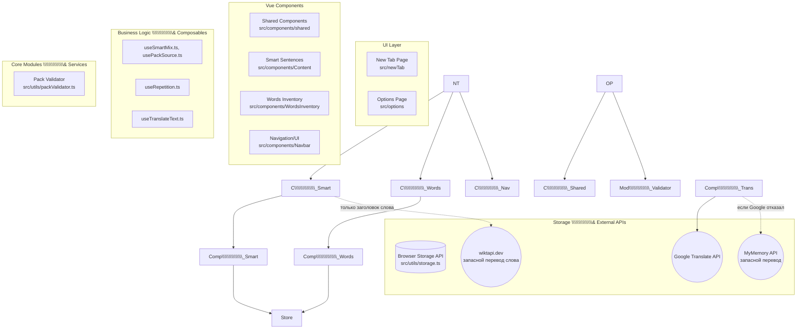

# Архитектурная карта проекта LingoTab

## 1\. Обзор проекта (Project Overview)

**LingoTab** — это браузерное расширение (версия 2.8.0), которое превращает стандартную "Новую вкладку" (New Tab) браузера в интерактивный инструмент для изучения английского языка.

**Главное назначение:** Замещение пустой новой вкладки полезным образовательным контентом, мотивирующим пользователя регулярно практиковать английский язык небольшими порциями (microlearning).

**Ключевая проблема, которую он решает:** Прокрастинация и нехватка времени на изучение языка. Помещая образовательный процесс в новую вкладку, расширение интегрирует обучение в ежедневный серфинг в интернете, делая его ненавязчивым и постоянным.

## 2\. Основной функционал (Core Features)

Функционал проекта полностью соответствует заявленным возможностям в документации (README.md), предоставляя комплексный инструмент для изучения языка:

* **Кастомизированная Новая вкладка (New Tab):** Основной UI расширения, который отображается при каждом открытии новой вкладки.
* **Инвентарь слов (Words Inventory) и Списки слов:** Модуль для управления словарным запасом. Включает базы слов (>10,000 слов из GMAT, GRE, TOEFL и др.) и позволяет сохранять в избранное (Favorites). Реализован в `src/components/WordsInventory`.
* **Поиск, Импорт и Экспорт:** Возможность искать новые слова и управлять своим прогрессом через загрузку/выгрузку данных словарного запаса.
* **Значения, Примеры и Переводы:** Значения слов подтягиваются через систему из нескольких словарных источников (см. ниже — "Источники словарных данных"), плюс Google Translate API (`src/composables/useTranslateText.ts`) для быстрого перевода, с автоматическим переключением на запасные сервисы, когда Google недоступен (см. ниже — "Слой перевода").
* **Произношение (Аудио):** Озвучивание правильного произношения изучаемых слов (логика в `src/modules/audio.ts`).
* **Режим интервального повторения:** Тренировочные сессии для возвращения к изученным словам, заложенные в алгоритме `src/composables/useRepetition.ts`.
* **Smart Sentences (Умные предложения):** Механика предложений для практики грамматики и перевода. Поддерживает два источника данных (`packSource`), управляемых через `src/composables/smartSentences/usePackSource.ts`:

  1. **Built-in:** Встроенный базовый набор. С версии 2.7.2 существует в 10 вариантах перевода (`src/data/smartSentences/builtInPack.ts` — русский по умолчанию, плюс `builtInPack.<код>.ts` для uk/ja/zh-CN/hi/ar/fr/de/pl/es). Нужный вариант подбирается автоматически по коду языка, выбранному в настройке "Translation language" (`src/composables/useGoogleTranslate.ts`), через словарь-подборщик `src/data/smartSentences/builtInPacks.ts` (`getBuiltInPackForLanguage`). Если для выбранного языка перевода нет — используется русский вариант по умолчанию. Английский текст предложений и вариантов ответа одинаков во всех файлах — переводу подлежат только поле `translation` и `hint.options\\\[].explanation`.

     Все 10 вариантов вместе — это \~800КБ исходников. Раньше они подключались обычным `import`, то есть попадали в общий бандл `newTab` целиком всем пользователям сразу, независимо от того, какой язык реально выбран — из-за этого сборка превышала предупреждение Vite о чанках больше 500КБ (реальный размер бандла на тот момент был 853КБ). С версии 2.7.5 `getBuiltInPackForLanguage` асинхронная и грузит нужный языковой пакет через `import()` — каждый вариант стал отдельным чанком (\~44-63КБ), подгружается только тот один, что реально нужен (главный бандл упал до \~288КБ). Оба места, которые её вызывают (`SmartSentencePractice.vue`, `MixedPractice.vue`), запускают эту загрузку сразу же, как только известен язык (он читается синхронно из `localStorage`, до всякого ожидания), **параллельно** с уже идущим чтением настроек через `storage.get(...)`, а не последовательно после него — иначе асинхронная подгрузка чанка добавляла бы заметную паузу поверх уже существующей, вместо того чтобы прятаться за ней. См. раздел 6 — "Параллельный запуск независимых асинхронных операций".

  2. **Uploaded:** Пользовательские импортированные JSON-файлы. Готовый запрос для любого ИИ-чата, по которому такой файл создаётся, лежит в `src/data/smartSentences/createPackPrompt.ts` и копируется кнопкой "Copy prompt" (`CreatePackPrompt.vue`). Запрос полностью самодостаточен — он сам задаёт пользователю нужные вопросы и не читает никаких настроек расширения.

  `packSource` — единственный источник истины: именно его читают `SmartSentencePractice.vue` и `MixedPractice.vue`, чтобы решить, какой пак показывать. Правило переключения: принятие нового пака (кнопка "Accept" после импорта файла в `ImportedPackRow.vue`) всегда безусловно переключает `packSource` на соответствующий источник, автоматически выключая тумблер Built-in, если он был включён.

  **Удалённая ИИ-генерация (с версии 2.8.0).** Раньше существовал третий источник — `packSource: 'ai'`, динамическая генерация через Groq API (`src/modules/aiProviders.ts`) с настройками уровня CEFR, тем, грамматики, длины предложений и частоты обновления. Всё это удалено: ту же задачу решает копируемый запрос для ИИ-чата, не требующий от пользователя API-ключа. **Но значение `'ai'` намеренно осталось живым при чтении** в `usePackSource.ts` и в ветке `else` у `SmartSentencePractice.vue` / `MixedPractice.vue`: у пользователей, успевших сгенерировать пак, он лежит в хранилище (`lastSmartPack`) и продолжает проигрываться как раньше. Записать это значение больше нечему, то есть источник доступен только "на выход" — переключиться с него на встроенный или импортированный пак можно, обратно нельзя. Осознанный компромисс: миграция стоила бы кода, а так удаление функции не отнимает контент у тех, кто им уже пользуется. Ключ `smartDailyApiKey` (сохранённый ключ Groq) тоже остаётся в хранилище мёртвым грузом — чистка намеренно не делалась, как и с `targetLang`.

  **Язык — один на всё расширение (с версии 2.7.6).** Раньше язык задавался в двух местах: настройкой "Translation language" на вкладке Main Settings (ключ `gttl`) — она определяла язык встроенного пака, — и отдельным дропдауном "Target language" на вкладке Smart Sentences (`smartDailySettings.targetLang`), который определял язык переводов и пояснений у ИИ-генерации. Два похожих поля с разным эффектом регулярно путали: выбрав язык только на странице Smart Sentences, пользователь всё равно получал русский встроенный пак. Дропдаун убран, `targetLang` больше не читается и не пишется. У существующих пользователей старое значение `targetLang` остаётся лежать внутри `smartDailySettings` мёртвым грузом — оно ни на что не влияет, чистка намеренно не делалась. С версии 2.8.0, после удаления ИИ-генерации, второго языкового поля не существует в принципе: язык задаётся ровно одной настройкой "Translation language" и определяет и переводы, и вариант встроенного пака.

  **Состояния по умолчанию (с версии 2.7.6).** Расширение ничего не записывает в хранилище при установке, поэтому "значение по умолчанию" здесь буквально означает "что подставить, когда ключа в `localStorage` нет". Единого файла с дефолтами в проекте не существует — каждое место подставляет своё. Для Smart Sentences набор такой: главный тумблер выключен, а Hints, "Mix words \& sentences" и Built-in sentence pack — включены, Words per sentence = 5. Смысл: пользователю достаточно щёлкнуть один главный тумблер, чтобы увидеть всю механику целиком, не включая каждую подсказку вручную.

  Ключевая тонкость реализации: раньше такие настройки читались как `!!значение`, то есть код не отличал "пользователь ещё ничего не трогал" от "пользователь сознательно выключил". Пока дефолтом было "выключено", разницы не было; с дефолтом "включено" наивная правка привела бы к тому, что выключенная настройка сама включалась бы обратно при каждом чтении. Поэтому теперь используется `значение ?? true` — явно записанный `false` уважается. У Built-in pack случай отдельный: его "выключено" пишется не как `false`, а как `smartPackSource: null` (см. `setSource(null)`), а `null ?? 'builtin'` вернуло бы `'builtin'` и сделало бы тумблер невыключаемым — поэтому там проверяется именно `undefined` (ключа нет) против `null` (выключен осознанно). Различие надёжно: `storage.get` возвращает `undefined` для отсутствующего ключа и `null` для записанного `null`. Затронутые места: `Hints.vue`, `MixMode.vue`, `usePackSource.ts`, `useSmartMix.ts`, `SmartSentencePractice.vue`, `MixedPractice.vue`. Побочное следствие, о котором стоит помнить: у существующих пользователей, ни разу не трогавших эти три настройки, ключей в хранилище тоже нет — значит после обновления они включатся и у них.

* **Источники словарных данных (Dictionary Providers):** С версии 2.7.3 определения слов и аудио-произношение можно получать из двух разных внешних сервисов, за что отвечает диспетчер `src/composables/words/wordProvider.ts`:

  1. **Wiktionary** — с версии 2.7.6 основной источник (на практике оказался стабильнее и быстрее второго), реализован в `src/composables/words/providers/wiktionaryProvider.ts`. Определения приходят как HTML (провайдер вырезает разметку через `DOMParser`), а аудио-файл ищется в 2 дополнительных запроса: сперва список медиафайлов страницы, затем реальная ссылка на файл через API Wikimedia Commons. У Wiktionary в этом API нет фонетической транскрипции (IPA) — она технически существует, но только внутри полной HTML-страницы статьи вперемешку с другими языками, поэтому сознательно не подключена (не стоит того ради резервного источника, а с версии 2.7.6 её отсутствие уже сказывается на большинстве слов, но это принятый компромисс).
  2. **Free Dictionary API** (`api.dictionaryapi.dev`) — запасной источник, `src/composables/words/providers/dictionaryApiDevProvider.ts`.

  **Устойчивость к сбоям (с версии 2.7.6), общая для обоих провайдеров:**

  * `src/composables/words/providers/fetchWithTimeout.ts` — оборачивает `fetch()` в `AbortController` с тайм-аутом 3 секунды (`DEFAULT\\\_FETCH\\\_TIMEOUT\\\_MS`). У обычного `fetch()` тайм-аута нет вовсе — без этой обёртки один зависший (не отвечающий вообще) запрос мог держать загрузку слова десятки секунд. Обёртка используется не только словарями, но и всем слоем перевода. Третьим (необязательным) параметром принимает обычные настройки запроса — метод, заголовки, тело: это нужно единственному вызывающему, который не `GET`, а `POST`, — пакетному переводу карточек грамматики. Сигнал прерывания подставляется последним, чтобы вызывающий не мог случайно его затереть.
  * `src/composables/words/providers/fetchWithRetry.ts` — построен поверх неё: до 3 повторных попыток с нарастающей паузой (400/800/1200мс) при быстрых ошибках (502/503 и т.п.). Но если конкретная попытка не ответила вовсе (сработал тайм-аут) — повторы сразу прекращаются, ошибка летит наверх немедленно: зависшее соединение вряд ли "оживёт" от немедленного повтора, разумнее сразу отдать эстафету второму источнику. Используется обоими провайдерами для всех своих запросов (Wiktionary — определение, список медиафайлов, ссылка на аудио; Free Dictionary API — сам запрос определения), поэтому ни один отдельный запрос не может зависнуть бесконечно ни у одного из источников.

  Оба провайдера приводят ответ к одному общему формату `IWordDefinition` (`src/composables/words/wordEntry.ts`), поэтому компоненты экрана слова (`Word.vue`, `Phonetic.vue`, `Actions.vue`) не знают и не должны знать, откуда пришли данные. Какой источник использовать, решает настройка "Dictionary source" (`src/options/Sections/DictionarySource.vue`, хранится через `src/composables/words/useDictionarySource.ts`) с тремя вариантами:

  * **Automatic (по умолчанию):** пробует Wiktionary; если он не ответил (после всех своих повторных попыток) — тихо, без ошибки на экране, пробует Free Dictionary API.
  * **Free Dictionary API:** принудительно только этот источник, без запасного варианта.
  * **Wiktionary:** принудительно только этот источник, без запасного варианта.
* **Слой перевода (Translation Layer):** Все переводы в расширении идут через единый composable `src/composables/useTranslateText.ts`, обращающийся к неофициальному JSON-эндпоинту Google Translate (`translate.googleapis.com/translate\\\_a/single`). У этого эндпоинта нет ни документации, ни квот, ни возможности запросить лимит — он защищён эвристикой против накрутки и отвечает `429` при малейшем подозрении.

  **Ключевой факт, установленный экспериментально 28.08.2026 — он важнее всего остального в этом разделе.** Основная причина `429` — **не** частота запросов, а то, каким браузером сделан запрос. В Chrome и Firefox, запущенных на одном и том же компьютере, с одним и тем же IP, в один и тот же момент, эндпоинт ведёт себя по-разному: в Chrome переводит нормально, в Firefox отказывает на каждом слове, которого нет в кэше. Причина видна в заголовках запроса: Chrome сам, на уровне браузера, добавляет к обращениям на домены Google подпись подлинности — `X-Client-Data`, `X-Browser-Validation`, `X-Browser-Channel`, `X-Browser-Copyright`, `X-Browser-Year`. Ни Firefox, ни любой сторонний скрипт этого не отправляют, и Google относится к ним заведомо строже.

  Практические следствия, чтобы не ходить по кругу: **для Firefox это постоянное состояние, а не блокировка, которая снимется.** Ожидание (сутки и дольше), смена IP и VPN проверены и не помогают — более того, дата-центровые адреса (то есть любой VPN и любой прокси-сервис) Google ограничивает жёстче всего. Прокси-зеркала вроде Lingva как решение тоже отпадают: они наследуют ту же проблему на своём дата-центровом IP, а для раздаваемого расширения это ещё и единая точка отказа плюс прогон всех пользовательских слов через чужой сервер.

  Отсюда два направления в устройстве слоя: минимизировать число запросов к Google (пункты 1–3) и иметь работающие запасные источники, когда Google отказывает (пункты 4–5). Механизмы:

  1. **Кэш в localStorage** (ключ `gtr\\\_cache\\\_v1`, до 1500 записей) — любой уже полученный перевод больше никогда не запрашивается заново. Кэш живёт между обновлениями расширения и не привязан к версии.
  2. **Пакетный запрос (`translateBatch`)** — вместо запроса на каждый текст все тексты склеиваются через `\\\\n` и уходят одним POST-запросом. Google может дополнительно разрезать отдельную строку на свои сегменты (например, если в ней два предложения), поэтому ответ собирается обратно не по счёту сегментов, а по эху оригинального текста, которое Google возвращает вместе с каждым сегментом: границы режутся только там, где стоял наш собственный `\\\\n`. Если после сборки количество кусков не совпало с отправленным, происходит откат на одиночные запросы — так рассинхрон физически не может показать перевод не на своём месте. Этот запрос — единственный `POST` во всём проекте, поэтому именно ради него `fetchWithTimeout` умеет принимать настройки запроса; до версии 2.7.6 тайм-аута у него не было вовсе, и зависший (не отвечающий) запрос оставлял карточку грамматики со скелетонами навсегда, не показывая даже русский запасной текст.
  3. **Отказ от «размножения» запросов при ошибке.** Критичный инвариант: сетевая ошибка или `429` **не** приводят к откату на одиночные запросы. Обычная причина такой ошибки — что Google уже нас ограничил, и отвечать на это новой пачкой запросов бессмысленно в любом случае: либо это ограничение по IP, и тогда всплеск запросов его только продлевает, либо это Firefox (см. выше), и тогда пятнадцать повторов откажут ровно так же, как один. Откат на одиночные запросы допустим **только** при рассинхроне сегментов, то есть когда ответ пришёл корректно, но не собирается. Если это правило убрать, расширение начнёт само себя блокировать.
  4. **Универсальный запасной переводчик — MyMemory** (`src/composables/myMemoryTranslation.ts`, `fetchTranslationFallback`). Подключён внутри самой `translate()`, поэтому автоматически покрывает все места, которые ей пользуются: заголовок слова, тултипы определений и примеров, обычные блочные переводы. Общая цепочка получается такая: **Google → MyMemory → Wiktionary** (последний — только для заголовка слова, см. пункт 5). Эндпоинт — `api.mymemory.translated.net/get`, без ключа и без регистрации.

     Четыре особенности этого API, каждая из которых легко создаёт баг, если о ней не знать:

     * **Об ошибках он сообщает под видом успеха.** HTTP-статус приходит `200`, но вместо перевода в поле `responseData.translatedText` лежит текст ошибки — например `QUERY LENGTH LIMIT EXCEEDED. MAX ALLOWED QUERY : 500 CHARS` или `MYMEMORY WARNING: YOU USED ALL AVAILABLE FREE TRANSLATIONS FOR TODAY...` (английский капс на \~180 символов, со ссылкой и названием сервиса внутри). Поэтому решение принимается по полю `responseStatus`, а **не** по `res.ok`, и текст ошибки не показывается пользователю ни при каких обстоятельствах. Это не теоретическая осторожность: в поиске легко найти реальные интернет-магазины, у которых `MYMEMORY WARNING...` стоит названием товара, потому что их движок перевода положил ответ сервиса прямо в контент.
     * **Жёсткий потолок в 500 символов на запрос.** Всё, что длиннее, проверяется до отправки и сразу считается неудачей — незачем тратить обращение к сети, чтобы узнать об этом от сервера.
     * **Дневная квота** — 5000 символов на IP при анонимном использовании. Электронная почта в запросах намеренно **не** передаётся, хотя и подняла бы лимит до 50000: в раздаваемом расширении один адрес означал бы общую квоту сразу на всех пользователей (кончится мгновенно) плюс личный адрес в открытом исходнике. Анонимный режим даёт каждому пользователю его собственные 5000. Исчерпание квоты сервис помечает флагом `quotaFinished`; после первого такого ответа модульный флаг `quotaExhausted` перестаёт дёргать сервис впустую до следующей перезагрузки страницы (а каждая новая вкладка — это и есть перезагрузка, так что сброс квоты обнаружится сам).
     * **Скорость сильно плавает** — замеры дали 0.5, 1.5 и 7 секунд на одинаковых запросах. Отсюда собственный тайм-аут в 4 секунды (длиннее словарных трёх, но короче ожидания, которое можно терпеть в тултипе).

     Результат MyMemory, в отличие от Wiktionary из следующего пункта, **кладётся** в общий кэш `gtr\\\_cache\\\_v1`. Решение противоположное — и намеренно: без кэширования дневная квота сгорела бы на повторных просмотрах одних и тех же слов. Цена компромисса: если Google потом заработает, у уже просмотренных слов останется чуть менее точный перевод из MyMemory. Для Firefox это неважно (Google там и не заработает), для Chrome случай редкий. Коды языков нормализуются своей таблицей `LANGUAGE\\\_CODE\\\_ALIASES` — она **не совпадает** с таблицей в `wiktionaryWordTranslation.ts`: MyMemory понимает `zh-CN`/`zh-TW` как есть, и переименовать нужно только устаревшие `iw` → `he` и `jw` → `jv`.

  5. **Запасной переводчик только для заголовка слова** (`src/composables/wiktionaryWordTranslation.ts`, `fetchWordTranslationFallback`) — последнее звено цепочки: используется, только если недоступны и Google, и MyMemory, и только в двух местах, помеченных `variant="word"` в `Translation.vue` (заголовок слова, слово на карточке повторения). Источник — стороннее API `api.wiktapi.dev` (обёртка над данными Wiktionary), у которого есть таблицы переводов целых слов, но нет данных для перевода произвольных предложений — поэтому определения, примеры и карточки грамматики этот запасной путь не покрывает. Wiktionary группирует переводы по смыслу слова в порядке, в котором их разместили на странице, а не по частоте использования, так что первый найденный перевод иногда оказывается редким/вторичным значением, а не самым распространённым — осознанный компромисс: альтернатива — пустое место, а не более качественный перевод. Код языка перед сравнением нормализуется через небольшую таблицу соответствия (`LANGUAGE\\\_CODE\\\_ALIASES`), так как у части языков в `googleTranslateLanguages.ts` используются старые коды Google (`zh-CN`/`zh-TW`, `iw`, `jw`), не совпадающие с кодами Wiktionary (`zh`, `he`, `jv`). Результат этого запасного пути **никогда не попадает** в общий кэш `gtr\\\_cache\\\_v1` — он живёт только в памяти текущего компонента, поэтому при следующем открытии того же слова Google пробуется заново, а не блокируется навсегда неточным кэшированным переводом.
  6. **Уведомление пользователя о том, что перевода нет.** Общее (не per-компонентное) состояние в `src/composables/useTranslateFailureNotice.ts` — модуль-синглтон, ровно тот же паттерн, что и в `useWordDefinitions.ts`. Сама плашка — `src/components/shared/GoogleTranslateErrorBanner.vue`, смонтирована один раз в `newTab/App.vue` над всем макетом страницы.

     Главное правило: **плашка показывается только тогда, когда не сработал ни один источник.** Если Google отказал, а MyMemory перевёл — пользователь не должен ничего заметить, иначе в Firefox плашка висела бы постоянно при полностью работающем переводе. Отдельной проверки для этого не нужно: `translate()` бросает ошибку только после провала обоих сервисов, а `catch` в `Translation.vue` вызывает `reportFailure()` лишь после того, как и Wiktionary ничего не дал. Так как `Translation.vue` используется только для заголовка слова и тултипов определений/примеров (Grammar Reference получает переводы напрямую через `translateBatch`, минуя этот компонент), уведомление никогда не возникает из-за карточек грамматики.

     `reportFailure()` принимает причину — `'quota'` или `'unavailable'`, — и от неё зависит текст: про исчерпанный дневной лимит запасного сервиса (штатное, самовосстанавливающееся состояние — звучать должно спокойно) либо про то, что не удалось достучаться никуда. Оба текста, как и весь остальной интерфейс, идут через `t()` и переводятся вместе с ним (см. раздел 7). Оба упоминают, что уже открытые слова продолжают показывать сохранённые переводы — это правда (кэш работает) и снимает впечатление, что сломалось всё.

     Ту же причину показывает и сам тултип, если перевода в нём нет (`Daily translation limit reached` / `Translation unavailable`). Хранится она в `Translation.vue` локально, отдельно от состояния плашки — намеренно: пользователь смотрит именно в тултип, который только что открыл, и закрытая плашка не должна лишать его объяснения. Раньше в этом случае открывался просто пустой пузырёк.

     Закрытие плашки хранится не в памяти, а в `localStorage` (ключ `gttf\\\_dismissed\\\_until`) — метка времени "молчать до". Причина: LingoTab заменяет системную "новую вкладку" браузера, а значит каждая новая вкладка — это полная перезагрузка страницы с нуля; если бы состояние жило только в памяти, плашка возвращалась бы заново на **каждой** новой вкладке, пока перевод недоступен, и это стало реальной жалобой при тестировании (а с учётом того, что в Firefox это состояние постоянное, иначе она была бы там вечным спутником). `dismiss()` записывает "молчать 30 минут"; `reportFailure()` при новой неудаче сначала проверяет, не находимся ли мы всё ещё в этом окне, и если да — не показывает плашку повторно. Это компромисс, а не постоянное отключение: если перевод недоступен дольше получаса или отказ повторяется позже, пользователь всё равно получит новое уведомление, а не останется молча гадать, почему переводов нет.

  Компоненты пользуются этим слоем двумя разными способами, и это осознанное разделение:

  * **Через компонент `src/components/Content/Translation.vue`** — точечные переводы. В режиме `display="block"` (перевод самого слова, перевод на карточке повторения) запрос уходит сразу при появлении на экране. В режиме `display="tooltip"` (значки «?» рядом с определениями и примерами в `Word.vue`) перевод запрашивается **только по клику пользователя**: у многозначного слова на одной вкладке части речи бывает 20-40 определений и примеров, и раньше все они переводились при отрисовке, хотя пользователь открывал единицы из них.
  * **Напрямую через `translateBatch`** — панель грамматики `src/components/Content/TenseCardsPanel.vue`. Её контент написан по-русски прямо в данных (`src/data/smartSentences/tenseCards/\\\*`, блоки с флагом `trRu: true`), и при целевом языке, отличном от русского, переводится на лету — это \~15 текстов на карточку, поэтому панель не использует `Translation.vue`, а сама собирает все тексты активной карточки и делает один пакетный запрос, показывая на время загрузки скелетоны. Если перевод получить не удалось, отображается исходный русский текст, а не пустое место. При целевом языке «русский» панель не делает ни одного запроса.

    Запасной MyMemory сюда намеренно **не** подключён: его потолок в 500 символов ломает саму идею пакетной отправки, пришлось бы слать \~20 отдельных запросов и выжигать примерно четверть дневной квоты на один просмотр карточки. Осознанная цена этого решения: для пользователя с нерусским целевым языком в Firefox, где Google отказывает всегда, проза карточки (заголовки, описания, заметки) останется русской, то есть нечитаемой — английские примеры при этом видны, они в данных лежат отдельно. Подставить вместо русского английский нельзя: в `tenseCards/types.ts` у блока есть только русский `text` и флаг `trRu`, английской версии этой прозы в данных просто нет. Чтобы это исправить, нужно дописать английские тексты примерно в 19 файлов карточек — работа с контентом, а не с кодом.

* **Язык интерфейса (с версии 2.8.0):** Подписи самого расширения переведены на несколько языков и переключаются настройкой "Interface language" в Main Settings → General. По умолчанию стоит "Auto" — интерфейс следует языку, выбранному в "Translation language". **Подробно устройство описано в разделе 7** — там же правила, которые нужно соблюдать при добавлении любой новой строки в интерфейс.
* **Кастомизация UI и Навигация:**

  * Темы оформления (Светлая/Тёмная) и настраиваемый фон (`src/composables/useTheme.ts`).
  * Закладки (Site Shortcuts), сохраняющие привычный функционал браузера.
  * Полноценная страница настроек (`src/options`).
* **История:** Просмотр недавно показанных слов, даже если вкладка была закрыта.
* **Локальное хранение:** Использование хранилища браузера (`src/utils/storage.ts`) для сохранения прогресса, настроек и пользовательских данных без необходимости внешней базы данных.

## 3\. Визуальная архитектура (Architecture Diagram)



## 4\. Карта файлов и директорий (Directory \& File Mapping)

```text
LingoTab/
├── extension/          # Итоговая папка (собирается Vite), готовая для загрузки в браузер.
├── scripts/            # Вспомогательные Node.js скрипты для сборки (prepare, pack).
└── src/                # Исходный код расширения
    ├── components/     # Переиспользуемые Vue-компоненты
    │   ├── Content/         # Компоненты основного контента новой вкладки (Word.vue, Translation.vue, RepetitionBlock.vue и т.д.).
    │   ├── Navbar/          # Верхняя навигация.
    │   ├── WordsInventory/  # UI управления словарным запасом.
    │   └── shared/          # Общие UI-элементы дизайн-системы: Toggle.vue, Checkbox.vue,
    │                        # ActionButton.vue, PrimaryButton.vue, SearchInput.vue, AiTag.vue,
    │                        # Skeleton.vue, Modal.vue, Drawer.vue, IconButton.vue, FileSelector.vue,
    │                        # GoogleTranslateErrorBanner.vue (см. раздел 2 — "Слой перевода",
    │                        # пункт 6), WordList/. См. раздел 6 — "Общие UI-компоненты".
    │
    ├── composables/    # Бизнес-логика в виде Vue Composables (Composition API)
    │   ├── smartSentences/  # Логика работы с "умными предложениями" (выбор источника `usePackSource.ts`).
    │   ├── words/           # Логика инвентаря слов.
    │   │   ├── providers/       # Источники словарных данных: `wiktionaryProvider.ts`,
    │   │   │                    # `dictionaryApiDevProvider.ts`, плюс общие `fetchWithTimeout.ts` /
    │   │   │                    # `fetchWithRetry.ts` (см. раздел 2 — "Источники словарных данных").
    │   │   ├── wordProvider.ts  # Диспетчер — выбирает провайдер по настройке, обрабатывает fallback.
    │   │   ├── wordEntry.ts     # Общий формат слова (`IWordDefinition`), одинаковый для всех провайдеров.
    │   │   └── useDictionarySource.ts # Хранение выбора источника (настройка "Dictionary source").
    │   ├── useRepetition.ts # Алгоритм интервального повторения.
    │   ├── useTranslateText.ts # Взаимодействие с API перевода: `translate` (один текст,
    │   │                    # со встроенным откатом на MyMemory) и `translateBatch`
    │   │                    # (пачка одним запросом) + кэш в localStorage.
    │   │                    # См. раздел 2 — "Слой перевода".
    │   ├── myMemoryTranslation.ts # Универсальный запасной переводчик через
    │   │                    # api.mymemory.translated.net. Раздел 2, пункт 4.
    │   ├── wiktionaryWordTranslation.ts # Запасной переводчик заголовка слова через
    │   │                    # api.wiktapi.dev. См. раздел 2 — "Слой перевода", пункт 5.
    │   ├── useTranslateFailureNotice.ts # Общее состояние "перевода нет совсем" (с причиной)
    │   │                    # для баннера GoogleTranslateErrorBanner.vue. Раздел 2, пункт 6.
    │   └── useBackground.ts # Логика, связывающая UI с фоновыми скриптами браузера.
    │
    ├── data/           # Статические данные
    │   └── smartSentences/builtInPack.ts # Встроенный базовый пакет предложений.
    │
    ├── i18n/           # Перевод интерфейса самого расширения. См. раздел 7.
    │   ├── en.ts            # Эталонный список всех ключей + английский текст.
    │   ├── index.ts         # Функция `t()`, реестр переводов, `translatedLanguageCodes`.
    │   ├── useUiLanguage.ts # Какой язык показывать (ключ `uil`, режим "auto").
    │   └── ru.ts, uk.ts, pl.ts, de.ts, ja.ts # Языки, по одному файлу на язык.
    │
    ├── modules/        # Изолированные сервисы и модули
    │   ├── audio.ts         # Логика воспроизведения звука (произношение).
    │   └── localStorage.ts  # Обертки над стандартным LocalStorage.
    │
    ├── newTab/         # Точка входа для страницы "Новая вкладка"
    │   ├── index.html       # HTML-каркас.
    │   ├── main.ts          # Инициализация Vue приложения.
    │   └── App.vue          # Корневой компонент новой вкладки.
    │
    ├── options/        # Точка входа для страницы настроек
    │   ├── index.html       
    │   ├── main.ts          
    │   ├── App.vue          
    │   ├── SettingsTabs.vue # Левое меню (сайдбар) с переключением вкладок настроек.
    │   ├── components/      # SettingsGroup.vue (карточка-категория), Section.vue (строка
    │   │                    # настройки), Select.vue (дропдаун). См. раздел 6.
    │   └── Sections/        # Разделы настроек (напр. SmartDailySentences для управления источниками).
    │
    ├── styleGuide/     # Отдельная, НЕ входящая в сборку точка входа — живая витрина всех
    │                   # общих компонентов и дизайн-токенов. Открывается только через
    │                   # dev-сервер. См. раздел 6 — "Эталонная страница компонентов".
    │   ├── index.html
    │   ├── main.ts
    │   └── App.vue
    │
    ├── styles/         # Глобальные стили и дизайн-токены (CSS custom properties). См. раздел 6.
    │
    ├── utils/          # Утилитарные функции
    │   ├── storage.ts       # Обертка над Chrome/Browser Storage API для сохранения данных.
    │   └── packValidator.ts # Валидация JSON-схемы пользовательских паков предложений.
    │
    └── manifest.ts     # Исходный файл конфигурации манифеста расширения.
```

## 5\. Конфигурация и настройки (Configuration \& Settings)

* **`package.json`**

  * *Что настраивает:* Зависимости проекта (Vue 3, Vite, TypeScript, иконки) и скрипты npm (`dev`, `build`, `pack`, `start:chromium`, `start:firefox`). Используется пакетный менеджер `pnpm`. Зависимость `@fontsource-variable/inter` встраивает шрифт Inter Variable прямо в расширение (см. раздел 6).
  * *Влияние:* Управляет версиями библиотек и процессом разработки. Инструмент `web-ext` используется для быстрого запуска расширения в тестовом браузере.
* **`vite.config.mts`**

  * *Что настраивает:* Сборщик Vite.
  * *Ключевые параметры:*

    * `rollupOptions.input`: Определяет несколько точек входа — `newTab` и `options`.
    * `build.outDir`: Указывает папку сборки `extension/dist`.
    * Плагины `unplugin-vue-components` и `unplugin-icons` автоматически импортируют компоненты и иконки, избавляя от необходимости прописывать `import` вручную.
  * *Влияние:* Любое изменение путей или плагинов напрямую влияет на то, как собирается конечный бандл расширения.
* **`src/manifest.ts`**

  * *Что настраивает:* Файл манифеста браузерного расширения (Manifest V3), генерируемый динамически перед сборкой. **Единственный источник правды.** `extension/manifest.json` — результат сборки: `npm run clear` его удаляет, `scripts/prepare.ts` → `scripts/manifest.ts` создаёт заново, поэтому ручные правки в нём теряются при каждой сборке.
  * *Ключевые параметры:*

    * `chrome\\\\\\\\\\\\\\\_url\\\\\\\\\\\\\\\_overrides: { newtab: './dist/newTab/index.html' }`: Указывает браузеру заменять дефолтную новую вкладку на нашу страницу.
    * `options\\\\\\\\\\\\\\\_ui`: Регистрирует страницу настроек.
    * `host\\\\\\\\\\\\\\\_permissions`: Запрашивает разрешения на внешние запросы — Google Translate API (`https://translate.googleapis.com/\\\\\\\\\\\\\\\*`), Wiktionary и Wikimedia для запасного словарного источника (`https://en.wiktionary.org/\\\\\\\\\\\\\\\*`, `https://commons.wikimedia.org/\\\\\\\\\\\\\\\*`, `https://upload.wikimedia.org/\\\\\\\\\\\\\\\*`), а также `https://api.wiktapi.dev/\\\\\\\\\\\\\\\*` для запасного переводчика заголовка слова (см. раздел 2 — "Слой перевода"). С версии 2.8.1 в списке есть и `https://api.dictionaryapi.dev/\\\\\\\\\\\\\\\*` — раньше он отсутствовал, хотя это один из словарных источников.
    * `permissions: \\\['storage']`: Кодом не используется — всё хранится в обычном `localStorage`, а единственный вызов API расширений (`browser.runtime.openOptionsPage()`) разрешения не требует. Оставлено потому, что без него сборка не проходила валидацию Firefox; точная причина не установлена.
    * `content\\\\\\\\\\\\\\\_security\\\\\\\\\\\\\\\_policy`: Настройки CSP. `script-src` в режиме разработки дополняется `http://localhost:<порт>` (`isDev`) — без этого `npm run dev` не работает, так как скрипты отдаёт сервер Vite. `img-src` разрешает `data:` (фон, выбранный файлом) и `https://icons.duckduckgo.com` (фавиконки закладок, `SiteShortcuts/Shortcut.vue`). Известное следствие: фон, заданный **ссылкой** в настройках (`Background.vue`), этим CSP не разрешён.
    * `browser\\\\\\\\\\\\\\\_specific\\\\\\\\\\\\\\\_settings.gecko`: ID расширения и `strict\\\\\\\\\\\\\\\_min\\\\\\\\\\\\\\\_version: 109.0` (версия Firefox, с которой поддерживается Manifest V3). Обязателен для addons.mozilla.org, Chrome этот ключ игнорирует — отдельная сборка под Firefox не нужна. Здесь же `data\\\\\\\\\\\\\\\_collection\\\\\\\\\\\\\\\_permissions: { required: \\\['none'] }` — заявление Mozilla о собираемых данных (у расширения нет своего сервера, аналитики и телеметрии). Значение приводится через `as Manifest.FirefoxSpecificProperties` только потому, что ключ новее пакета типов `@types/webextension-polyfill` — когда типы обновятся, приведение можно убрать.

    Проверять сборку тем же линтером, что стоит за валидацией AMO, можно локально: `npm run build && npx web-ext lint --source-dir ./extension`. Именно в таком порядке — после `npm run dev` в `extension/dist` лежат заглушки со ссылками на localhost, и линтер выдаёт два ложных `REMOTE\\\\\\\\\\\\\\\_SCRIPT`. Штатный результат на сегодня: 0 ошибок и 6 предупреждений (`UNSAFE\\\\\\\\\\\\\\\_VAR\\\\\\\\\\\\\\\_ASSIGNMENT`, `DANGEROUS\\\\\\\\\\\\\\\_EVAL`) — все они приходят из внутренностей Vue в собранном бандле, в нашем коде ни `v-html`, ни `innerHTML`, ни `eval` не используются нигде. Убрать их нельзя, апрув они не блокируют.
  * *Влияние:* Изменения здесь влияют на доступные расширению права (permissions) и его интеграцию с браузером.
* **`tsconfig.json`**

  * *Что настраивает:* Компилятор TypeScript.
  * *Ключевые параметры:* Строгий режим типизации, пути (`baseUrl`, `paths` для алиаса `@/`).
  * *Влияние:* Обеспечивает безопасность типов во всем проекте.
* **`eslint.config.mjs`**

  * *Что настраивает:* Правила линтера (ESLint) на базе конфигурации `@antfu/eslint-config`.
  * *Влияние:* Поддерживает единый стиль кода (форматирование, отступы, строгие проверки на неиспользуемые переменные, как это было с ошибкой импорта типа `Pack`).

## 6\. Архитектура стилей и дизайн-система (Styling Architecture \& Design System)

Проект использует компонентный подход к дизайну (Single-File Components) — стили лежат прямо в коде компонентов (`.vue` файлах), а не в одном гигантском CSS-файле. Начиная с редизайна 2026 года (визуальное обновление под макеты Figma, без изменения функциональности) поверх этого подхода выстроена единая система дизайн-токенов и общих UI-компонентов, описанная ниже.

### Изолированные стили (Scoped CSS)

Большинство файлов используют тег `<style scoped>` в самом низу файла. Слово **scoped** (изолированный) гарантирует, что стили применятся **только** к конкретному элементу. Изменение цвета кнопки в настройках никогда не сломает кнопки на главной странице.

### Где искать стили для страниц:

* **Главная страница ("Новая вкладка"):**

  * Каркас и сетка: `src/newTab/App.vue`.
  * Стили карточки слова, скелетоны скрытого слова/перевода: `src/components/Content/Word.vue`.
  * Ряд иконок над словом (Google Translate, скрыть, в закладки, следующее слово): `src/components/Content/Actions.vue`.
  * Карточка повторения выученных слов: `src/components/Content/RepetitionBlock.vue`.
  * Боковая панель со списками "Learning"/"Learned" (открывается по иконке закладок): каркас панели — `src/components/shared/Drawer.vue`, переключатель вкладок — `src/components/NavbarBottom/MarkedWords/Tabs.vue`, сам список слов — общий `src/components/shared/WordList/WordList.vue`.
  * Заглушки для нестандартных состояний (какая из них показывается — решает `src/components/Content/Content.vue`): не выбран ни один список слов — `src/components/Content/NoWordList.vue`; искомое слово не найдено в словаре — `src/components/Content/WordFetchError.vue`; нет подключения к интернету — `src/components/Content/OfflineState.vue`; все слова из выбранных списков уже выучены — `src/components/Content/LearnedAllWords.vue`.

    Какой пул слов используется и когда показывать две последние заглушки, решает `src/composables/words/useWord.ts` — единственное место, где живёт этот выбор. С версии 2.8.1 логика такая:

    * Флаг `isLearningOnlyMode` — настройка "Learning words only" включена **и** в личном списке юзера что-то есть. При нём пулом становится личный список (`useLearningWords.ts`, ключ `mw`), иначе — встроенные словари (`useWordLists.ts`).
    * **Личный список сильнее игнор-листа:** при `isLearningOnlyMode` игнорируемые слова (`useIgnoredWords.ts`, ключ `iw`) не применяются вовсе. В обычном режиме пул фильтруется по ним (`unIgnoredWords`).
    * `hasLearnedAllWords` сравнивает сами слова, а не размеры списков: "пул не пустой И в нём не осталось ни одного неигнорируемого слова". Раньше сравнивались длины (`пул <= игнор-лист`), из-за чего большой игнор-лист заставлял меньший пул выглядеть полностью выученным — баг 2.8.0, см. патч-нот.
    * `useRandomWord.ts` осознанно ничего про эти режимы не знает: он просто берёт случайное слово из переданного ему списка. Раньше он содержал вторую копию условия про "Learning words only" — расхождение этих двух копий и было причиной двух багов подряд (2.7.5 и 2.8.0). **Не возвращать логику выбора режима в этот файл.**
* **Страница Настроек (Options):**

  * Общий фон и структура: `src/options/App.vue`.
  * Левое меню (сайдбар): `src/options/SettingsTabs.vue`.
  * Группировка строк настроек в карточки: `src/options/components/SettingsGroup.vue` и `Section.vue` (см. ниже).
  * Стили конкретных блоков настроек лежат в соответствующих файлах в `src/options/Sections/` (например, `Theme.vue`).
* **Блок "Умные предложения" (Smart Sentences):**

  * Интерфейс тренировки и ввода текста: `src/components/Content/SmartSentencePractice.vue`.
  * Грамматический справочник под упражнением (объяснение времени, карточки типичных ошибок, блок "Trigger \& Contrast"): `src/components/Content/TenseCardsPanel.vue`.
  * Панель управления генерацией предложений: `src/options/Sections/SmartDailySentences/SmartDailySentences.vue`.

### Шрифт

Проект использует шрифт **Inter Variable**, встроенный (self-hosted) через пакет `@fontsource-variable/inter`, а не подключаемый с диска пользователя или с внешнего CDN. Подключается один раз в `src/styles/index.css`:

```css
@import '@fontsource-variable/inter';
@import '@fontsource-variable/inter/wght-italic.css';
```

Благодаря этому шрифт выглядит одинаково у всех пользователей, даже если Inter не установлен у них в системе.

### Дизайн-токены (Design Tokens)

Единственный общий файл стилей — это `src/styles/index.css`. Здесь нет стилей для конкретных кнопок — только CSS-переменные (custom properties), задающие всю палитру и типографику проекта. Переменные объявлены дважды: базовый набор в `:root` — это тёмная тема (тема по умолчанию), и переопределения в классе `.light` — светлая тема (класс вешается на `<body>`, см. `extension/initTheme.js`).

Основные группы переменных:

* **Фон и текст:** `--bg-color` (фон страницы), `--surface-color` (фон карточек/полей/дропдаунов — это НЕ то же самое, что фон страницы), `--color` (основной текст), `--text-secondary`, `--text-tertiary`.
* **Оверлеи:** `--overlay-weak` / `--overlay-strong` — полупрозрачные белые (тёмная тема) или чёрные (светлая тема) заливки, используются как мягкие подложки и рамки у большинства интерактивных элементов.
* **Акцент и статусы:** `--accent-color`, `--accent-color-hover` (80% непрозрачности), `--accent-color-tint` (10%, для мягких подложек типа активного пункта меню), `--success-color`, `--error-color`.
* **Токены под конкретные механики:** `--card-bg` (фон карточек-групп в настройках), `--toggle-track-off` (фон выключенного тумблера), `--primary-btn-bg` / `--primary-btn-border` (сплошная акцентная кнопка), `--border-color` (рамка карточек-блоков на экране грамматики/умных предложений).
* **Шрифт:** `--font-family-base`.

**Важный нюанс — тёмная и светлая темы не зеркальны.** Для нескольких токенов светлая тема — не "инверсия" тёмной, а отдельно заданное в Figma значение:

* `--card-bg`: в тёмной теме — полупрозрачная белая заливка (`var(--overlay-weak)`), в светлой — сплошной белый (`var(--surface-color)`).
* `--primary-btn-bg` / `--primary-btn-border`: в тёмной теме кнопка полупрозрачная (80% акцента) с нейтральной рамкой, в светлой — сплошная акцентным цветом кнопка со сплошной рамкой того же цвета.
* `--border-color`: в тёмной теме — слабый оверлей (`var(--overlay-weak)`, 5%), в светлой — сильный (`var(--overlay-strong)`, 10%). Подтверждено как системное решение конкретно для экрана грамматики — там абсолютно все рамки (поле ввода, дропдаун, карточки, чипы, разделители) следуют этому правилу.
* Фон страницы в светлой теме — не белый, а слегка тонированный `#F1F5F9`; чистый белый (`--surface-color`) зарезервирован под приподнятые поверхности (карточки, дропдауны, поля).

Отдельный случай — фон чипов-триггеров в `TenseCardsPanel.vue` (`--trigger-bg`, локальная переменная, а не глобальный токен): в тёмной теме это утопленная чёрная заливка 30% прямо поверх карточки, в светлой — просто белая поверхность с рамкой. Это не "слабый/сильный" вариант одного и того же значения, а два визуально разных решения, поэтому вынесено в переменную рядом с компонентом, а не в общий файл токенов.

Похожий случай — фон боковой панели "Marked Words" в `Drawer.vue` (`--drawer-bg`, тоже локальная переменная): в тёмной теме это обычный фон страницы (`--bg-color`), а в светлой — не тонированный фон страницы, а сплошной белый (`--surface-color`), как у карточек. `Drawer.vue` используется только этой панелью (у истории слов свой компонент, `Modal.vue`), поэтому переменная заведена локально, а не в общих токенах.

Эти значения сверены напрямую с Figma-файлом отдельно для каждой темы. При добавлении новых компонентов **не стоит предполагать симметрию между темами** — лучше проверить обе.

### Типографика (Type Scale)

Помимо цветовых переменных, в `src/styles/index.css` заведены **классы-утилиты** — один класс на каждый текстовый стиль из Figma. Использовать их вместо того, чтобы задавать шрифт/размер вручную в каждом компоненте:

|Класс|Figma-стиль|Где используется|
|-|-|-|
|`.text-display`|Headings/main word 56-60|Заголовок слова на главном экране|
|`.text-heading-32`|Headings/32-32|Заголовок страницы настроек, слово в карточке повторения|
|`.text-heading-18`|Headings/18-24|Заголовки строк настроек, переводы, пункты меню|
|`.text-heading-label`|Headings/13-16|Надписи-эйбрау (широкий трекинг) — категории настроек, "Settings" в сайдбаре|
|`.text-sentence`|Headings/Текст предложений Smart Sentences|Текст тренировки Smart Sentences|
|`.text-body`|Default text/16-24|Обычный текст, значения дропдаунов|
|`.text-body-sm`|Default text/13-16|Мелкий текст — подписи, кнопки|
|`.text-body-sm-italic`|Default text/13-16 Italic|Второстепенные подписи курсивом (например, счётчики "(1340 words)")|

### Общие UI-компоненты (`src/components/shared/`)

Раньше многие элементы интерфейса (переключатели, чекбоксы, кнопки, дропдауны) были скопированы вручную в разные файлы настроек и визуально расходились между собой. Теперь у каждого такого элемента есть один файл-первоисточник:

* `Toggle.vue` — переключатель вкл/выкл.
* `Checkbox.vue` — чекбокс (поддерживает слот для текста метки, чтобы клик по подписи тоже переключал чекбокс).
* `ActionButton.vue` — вторичная кнопка с иконкой и текстом (например, "Import file"). Не путать с `WordList/ActionButton.vue` — это другая, более старая кнопка только с иконкой без фона, используется в списках слов и карточке повторения.
* `PrimaryButton.vue` — сплошная акцентная кнопка (кнопки "Показать слово/перевод", "Generate now").
* `SearchInput.vue` — поле поиска/фильтра с иконкой лупы.
* `AiTag.vue` — маленький бейджик "AI" у заголовков разделов настроек, связанных с ИИ-генерацией.
* `Skeleton.vue` — блёклый прямоугольник-заглушка на месте скрытого текста (см. ниже).
* `Modal.vue` — всплывающее окно (попап): существовавший ранее компонент, полностью переведён на токены (фон `--surface-color`, рамка `--overlay-strong`, заголовок/подзаголовок на типографику, кнопка закрытия — та же плашка-иконка, что и везде). Используется всеми попапами приложения (история слов, словарь, добавление ярлыка, импорт файлов) — правка в одном месте применяется сразу везде.
* `Drawer.vue`, `IconButton.vue`, `FileSelector.vue`, `WordList/` — существовавшие ранее общие компоненты.

Дропдаун (`src/options/components/Select.vue`) не вынесен в `shared/`, так как он привязан к странице настроек. Это обёртка над нативным `<select>` браузера — сознательный выбор: раскрытый список опций рисует браузер/ОС, а не наш код, поэтому пиксель-в-пиксель повторить открытое меню из Figma нельзя, зато бесплатно достаются доступность и работа с клавиатурой.

### Компоновка страницы настроек

Обе вкладки настроек ("Main Settings" и "Smart Sentences") построены по единому паттерну из двух компонентов (`src/options/components/`):

* **`SettingsGroup.vue`** — обёртка-категория: подпись-эйбрау (опционально с бейджиком `AiTag`, проп `ai`), необязательное описание под подписью (проп `description`, добавлен в 2.7.6) и карточка под ними. Описание нужно, когда пояснение относится к группе целиком, а не к отдельной строке: сейчас его использует единственная группа "Proficiency \& Topics", чтобы сказать, что язык задаётся на другой вкладке настроек. Без пропа разметка группы не меняется.
* **`Section.vue`** — одна строка настройки внутри карточки: заголовок и описание слева, элемент управления (тумблер/дропдаун/кнопка, слот `#bar`) справа. Строки внутри одной группы автоматически разделяются линией (кроме первой в группе). Если заголовку с описанием не хватает места рядом с элементом управления — переносится текст, а сам элемент управления всегда остаётся на месте (не сжимается и не падает на новую строку).

### Скелетоны для скрытых слов/переводов

На экране показа слова кнопки "Показать слово" / "Показать перевод" (настройка "Hide translation under spoiler") показываются поверх блёклой заглушки (`Skeleton.vue`) того же размера, что и скрытый текст, — так карточка не меняет высоту при раскрытии. Заглушка — это заливка `#62666D` с прозрачностью 10% и блюром 4px; значение одинаковое в обеих темах (так сделано в самом Figma-файле, а не через `--text-tertiary`, которая в темах отличается).

### Координация с баннером ошибки перевода (GoogleTranslateErrorBanner.vue)

`Navbar.vue` (иконки поиск/тема/настройки) и сайдбар с закладками `SiteShortcuts.vue` — оба `position: fixed`, то есть не участвуют в обычном потоке страницы и не сдвигаются автоматически, когда `GoogleTranslateErrorBanner.vue` появляется над макетом (см. раздел 2, пункт 6). Вместо хардкода пиксельного отступа (баннер может занимать 1 или 2 строки — высота зависит от ширины окна) сам баннер измеряет свою реальную высоту через `ResizeObserver` и пишет её в CSS-переменную на `:root` — `--google-translate-banner-height` (0px, когда баннер скрыт). `Navbar.vue` прибавляет её к своему `top`, а `SiteShortcuts.vue` вычитает её из своей `height: 100%` (у него нет явного `top`, поэтому он и так корректно сдвигается вниз сам, через "статическую" позицию — но без уменьшения высоты съезжал бы за нижний край экрана на ту же величину). **Если в макет `newTab/App.vue` добавляется ещё один `position: fixed`/`position: absolute` элемент, привязанный к верхнему краю экрана, его тоже нужно завести на эту переменную**, иначе он будет наезжать на баннер точно так же, как раньше это делал `Navbar`.

Отдельная, обратная нестыковка: когда полоса закладок (`SiteShortcuts`) включена, она резервирует 55px слева, из-за чего `.main` (а вместе с ним и центрированный по `max-width: 800px` контент — слово, значения) физически начинается на 55px правее нуля. Баннер стоит вне этой раскладки и без поправки центрировался бы по всей ширине экрана, съезжая относительно текста слова. Поэтому `GoogleTranslateErrorBanner.vue` сам читает `isActive` из того же `src/composables/shortcuts/useShortcuts.ts`, что и `App.vue`, и добавляет себе `padding-left: 55px` (класс `.banner--sidebar-offset`) ровно тогда, когда полоса закладок видна.

### Параллельный запуск независимых асинхронных операций

`SmartSentencePractice.vue` (`loadPackAndState`) и `MixedPractice.vue` (`decideAndPrepare`) на старте делают два независимых асинхронных дела: читают настройки через `storage.get(...)` и, если нужен встроенный пакет предложений, грузят его чанк через `getBuiltInPackForLanguage()` (см. раздел 2, ленивая загрузка Smart Sentences). Целевой язык для второго действия не зависит от результата первого — он уже известен синхронно, из `localStorage` (`useGoogleTranslate()`). Поэтому обе операции запускаются **одновременно** (загрузка пакета стартует сразу, без `await`, и дожидается своего результата только там, где он реально нужен), а не одна после другой. Так время подгрузки чанка прячется за уже идущим чтением настроек, а не складывается с ним. Правило на будущее: прежде чем писать `await A(); await B()`, стоит проверить, действительно ли `B` нуждается в результате `A` — если нет, `const bPromise = B(); await A(); await bPromise` почти всегда быстрее без дополнительной сложности.

### Растягиваемое поле ввода (SmartSentencePractice.vue)

Поле ввода ответа на экране практики предложений — обычный `<textarea resize:vertical>` с рамкой/фоном самого блока, а не отдельная обёртка. Важное правило, которое здесь легко нарушить: внутренний отступ (`padding`) должен быть задан на самом `<textarea>`, а не на его контейнере. Если отступ повесить на контейнер, поле ввода (как элемент) окажется меньше контейнера на величину этого отступа — а вместе с ним и нативный "уголок" для растягивания в правом нижнем углу окажется сдвинут от истинного угла блока, а не прижат к нему. Кнопки "Tag"/"Check" при этом положены не под полем, а поверх его нижней части (`position:absolute`, с отступом `right` чуть меньше размера уголка) — иначе, если положить их в колонку под полем через `flex`, размер поля перестаёт корректно передаваться самому уголку и растягивание либо визуально "уезжает", либо вовсе перестаёт работать.

### Эталонная страница компонентов (Style Guide)

В `src/styleGuide/` лежит отдельная точка входа (`index.html` + `main.ts` + `App.vue`), которая использует те же самые файлы компонентов и тот же `src/styles/index.css`, что и настоящее расширение, — поэтому она физически не может разойтись с реальным видом продукта. Показывает все цвета, типографику и общие компоненты в обеих темах.

Эта страница **намеренно не входит в сборку расширения**: её нет ни в `rollupOptions.input` в `vite.config.mts`, ни в списке `views` в `scripts/prepare.ts`. Открыть её можно только через сервер разработки:

```bash
pnpm dev
```

а затем в браузере — `http://localhost:3030/styleGuide/index.html`.

## 7\. Локализация интерфейса (с версии 2.8.0)

Речь о языке **самого расширения** — подписей, кнопок и описаний настроек. Не путать со "Слоем перевода" из раздела 2: тот переводит изучаемые слова через внешние сервисы по сети, а этот просто подставляет заранее написанный текст из файлов в сборке. Общего у них ровно одно — настройка "Translation language" может управлять обоими.

Живёт всё в `src/i18n/`. Всего 159 ключей, покрывающих обе страницы настроек, экраны-заглушки, попапы импорта, верхнюю панель, боковые панели и экран тренировки предложений.

### Как устроено

**`en.ts` — единственный источник истины.** В нём перечислены все существующие ключи с английским текстом, и из него же выводится тип `MessageKey`. Файл любого другого языка типизирован как `Partial<Record<MessageKey, string>>`, из чего следуют два свойства: TypeScript не даст завести ключ, которого нет в английском (опечатка не превратится в мёртвую запись), но разрешит перевести не все — **недостающий ключ молча берётся из английского**. Откат происходит по каждому ключу отдельно, а не по языку целиком, поэтому неполный перевод безопасен и языки выкатываются по одному.

**`t(key)` из `index.ts`** — единственный способ получить текст. Вызывается из шаблонов. Внутри читает `uiLanguage`, и именно поэтому смена языка перерисовывает страницу без перезагрузки: `t()` выполняется при каждой отрисовке.

**`useUiLanguage.ts` — развязка**, ради которой всё и затевалось в таком виде. Ни один компонент не читает настройку языка напрямую; они знают только про `t()`. Благодаря этому правило "чему следует интерфейс" меняется в одном файле, не затрагивая \~200 мест вызова.

### Три решения, которые легко случайно сломать

**1. Переводы подключаются обычным `import`, а не `import()`.** Это сознательно противоположно тому, как загружаются паки предложений (раздел 2, пункт 1): те весят \~800КБ и грузятся лениво, а все языки интерфейса вместе — несколько десятков килобайт. Замер (девять языков реалистичного объёма): **+107КБ к общему чанку, разбор \~0,3 мс**. Для сравнения, один пак предложений весит 44–87КБ и грузится на каждой новой вкладке.

Ленивая загрузка здесь дала бы заметный дефект: страница успевала бы отрисоваться по-английски и через долю секунды перемаргивала на нужный язык — и так **на каждой новой вкладке**. Сейчас язык известен синхронно (чтение localStorage) ещё до первой отрисовки, поэтому промежуточного английского состояния не существует. Тот же принцип, что у `extension/initTheme.js`: то, что влияет на первый кадр, должно быть известно до первого кадра.

**2. По умолчанию интерфейс английский — и проверка на это обязательна.** `useGoogleTranslate()` подставляет **русский**, если ключ `gttl` никогда не записывался. Пока это влияло только на переводы слов, оно было безобидно; как только язык перевода стал управлять интерфейсом, тот же дефолт разворачивал бы на русский всё расширение у **каждого нового пользователя в мире**. Поэтому `resolveUiLanguage()` спрашивает `hasStoredTargetLanguage()` (экспорт из `useGoogleTranslate.ts`) и возвращает `'en'`, пока пользователь не выбрал язык перевода осознанно. Проверка выглядит избыточной ровно до того момента, когда её убирают.

**3. Дропдаун "Interface language" строит список сам** из `translatedLanguageCodes` — это `Object.keys(translations)`. Добавление языка в реестр `index.ts` автоматически добавляет его в дропдаун; второго списка, который нужно поддерживать, не существует, и предложить язык без перевода дропдаун физически не может. Хранится выбор в ключе `uil`: код языка либо строка `'auto'`. На `'auto'` интерфейс следует за языком перевода — поэтому `GoogleTranslate.vue` после сохранения зовёт `refreshUiLanguage()`, иначе страница вокруг дропдауна осталась бы на старом языке до перезагрузки и это читалось бы как баг.

### Правила для строк (следствие этапов подготовки)

Прежде чем выносить текст в ключи, английские формулировки были переписаны, а семь мест — перевёрстаны. Правила ниже не стилистические, они держат систему работоспособной:

* **Один ключ — одна цельная фраза.** Никогда не собирать предложение из кусков: порядок слов в языках разный, и куски складываются в бессмыслицу.
* **Никакой разметки внутри значения.** Иконка, ссылка или жирное слово живут в шаблоне вокруг строки, а не внутри неё. Ради этого переделаны три пустых списка, `NoWordList.vue`, `WordFetchError.vue` и общий блок требований к файлу в попапах импорта.
* **Никаких считаемых существительных рядом с числом.** "Found 5 words" стало "Words found: 5"; счётчик предложений на экране практики стал просто `3 / 20`. Причина: в русском, украинском и польском у существительного три формы, зависящие от последней цифры, а в японском форм нет вовсе.
* **Частоты повторения — семь отдельных ключей**, а не число в одной фразе. В `de.ts` и `ja.ts` они выглядят одинаковыми и кажутся дублированием; в обоих файлах стоит комментарий, объясняющий, что они нужны славянским языкам. Не "упрощать".
* **Имена собственные не переводятся** и ключами не становятся: LingoTab, Wiktionary, Free Dictionary API, Google Translate, названия словарей (GMAT, SAT, …), грамматические термины.

### Что осознанно осталось английским

* **108 названий языков** в дропдауне "Translation language" — переводить их на девять языков означало бы \~1000 строк ради списка, который и так читается.
* **Содержимое карточек грамматики** (`src/data/smartSentences/tenseCards/\\\*`) — там своя, совсем другая механика: текст лежит по-русски в данных и переводится на лету через `translateBatch` (раздел 2, "Слой перевода"). В `t()` его втягивать нельзя.
* **Patch Notes** — историческая запись об изменениях, переводу не подлежит. Переводится только название вкладки.

### Как добавить язык

1. Скопировать `en.ts` в `<код>.ts`, перевести значения, тип оставить `Partial<Record<MessageKey, string>>`.
2. Добавить импорт и одну строку в реестр `translations` в `index.ts`. Всё остальное — дропдаун, откат, мгновенное переключение — подхватится само.
3. Проверить вёрстку **замером, а не глазами**. В консоли открытой страницы:

```js
\\\[...document.querySelectorAll('\\\*')]
  .filter(e => e.children.length === 0 \\\&\\\& e.scrollWidth > e.clientWidth + 1)
```

плюс `document.documentElement.scrollWidth > document.documentElement.clientWidth`. Пустой результат означает, что ничего не обрезано и страница никуда не разъехалась.

Полезный приём для поиска забытых строк: временно подставить в реестр язык, где каждое значение получено из английского с префиксом, и выписать всё, что на экране без этого префикса, — там окажется либо жёстко вшитый текст, либо имя собственное.

