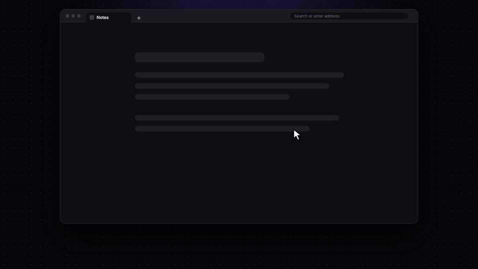

[Русский](README.ru.md) · [Українська](README.uk.md) · **English**

# LingoTab

> Learn English every time you open a new tab.

---

LingoTab is a Chrome and Firefox extension that turns the standard new-tab page into a tool for learning English.

Every time you open a new tab you get a random word with its meaning, translation and usage examples. You can interact with words to remember them better, and practise grammar on ready-made sentences — built-in or assembled yourself — building the habit of using what you have learned in context.

---

## Main features

* **🗣 Pronunciation** — hear how the words you are studying are pronounced.
* **📚 Meanings and examples** — exact definitions and real usage in context.
* **📖 Choice of dictionary source** — definitions and pronunciation come from Wiktionary or the Free Dictionary API. In Automatic mode the extension quietly switches to the backup source if the main one does not respond.
* **🌍 Word translation** — translations right in the new tab, into more than 100 languages. If the translation service is unavailable a backup steps in, and words you have already opened keep showing their saved translations. Any translation can be replaced with your own — see "Your own translations".
* **🙈 Hidden translation** — a self-check mode: the translation hides behind a "Show" button so you can recall the word yourself first.
* **✅ Marked words** — save words to study and review later.
* **🔍 Search for new words** — add any word you are curious about to your vocabulary in a couple of clicks.
* **📂 Import and export** — manage your vocabulary, keeping your data and your progress.
* **🔄 Review mode** — practice sessions that bring you back to words you have already learned.
* **📘 Vocabulary lists** — over 16,000 words from established study programmes: GMAT, GRE, Longman, Oxford, SAT, TOEFL.
* **🕒 History** — look through recently shown words, even if the tab was closed.
* **🌐 Interface language** — LingoTab's own labels are translated into several languages. By default the interface follows the language you picked for translations, but you can set it manually.
* **🎨 Themes** — choose the dark or the light look, whichever you prefer.
* **🖼 Custom background** — personalise how your new tab looks.
* **🔗 Shortcuts** — keep your favourite sites within reach right from the new tab, without losing what a browser's new-tab page normally does.

---

## Your own translations

Automatic translation does not always land on the meaning you actually need. Now any translation can be corrected and saved — your version is always shown instead of the automatic one.

**This also lifts the language limit.** You can add a word in any language — German, Polish, Japanese — write your own translation for it, and it will open just like the English ones, even if the English dictionary has never heard of it. That turns LingoTab into a tool for learning any language, not only English.

### What you can do:

* **✏️ Edit a translation** — the pencil next to a word, both on the card and in your Learning list. Your translation always wins over the automatic one.
* **➕ Add your own words** — the "Add word" button at the bottom of the Marked Words panel. Write the translation yourself, or fetch it automatically in one click.
* **📋 Translations in the Learning list** — each translation is visible right next to its word, and a separate sort mode brings words with your own translation to the top.
* **📴 Works without a connection** — if the translation service is unavailable, or the dictionary does not know the word, it still opens on a simplified card with your translation.
* **🔁 Import and export translations** — save your words together with their translations as a JSON file, or load a ready one.
* **🤖 Let AI collect the translations** — the settings, under "Import & export", hold a ready-made prompt. Copy it, paste it into any AI chat, and it will translate the words you need into your language and hand back a finished JSON file — all that is left is to load it in the same place.

---

## Smart Sentences

**Smart Sentences** is the feature that helps you learn English grammar through example sentences. You can practise grammatical structures and build the skill of using English in context.

### What you can do:

* **📦 Built-in sentence pack** — a ready-made pack ships with the extension, translated into 10 languages. The right one is picked automatically from the language chosen in "Translation language".
* **✍️ Your own sentence pack** — the "Copy prompt" button copies a ready-made prompt for any AI chat (ChatGPT, Claude and others). The chat asks a few questions and returns a file you can import into the extension.
* **💡 Grammar hints** — each sentence can come with a multiple-choice question that explains why that particular answer is the right one.
* **📗 Grammar reference** — below the exercise a card opens for the tense or structure that appeared in the sentence: an explanation, the typical mistakes, and the marker words it is recognised by.
* **⭐ Study side by side** — alternate sentence practice with ordinary word study, and set how often a sentence appears.

---

### Credits:

* Word definitions and pronunciation come from [Wiktionary](https://www.wiktionary.org/) (via the Wikimedia and Wiktionary APIs), with [Free Dictionary API](https://github.com/meetDeveloper/freeDictionaryAPI) as a fallback source.
* Based on: [new-word-tab](https://github.com/sajadhsm/new-word-tab) by Sajad Hashemian.
