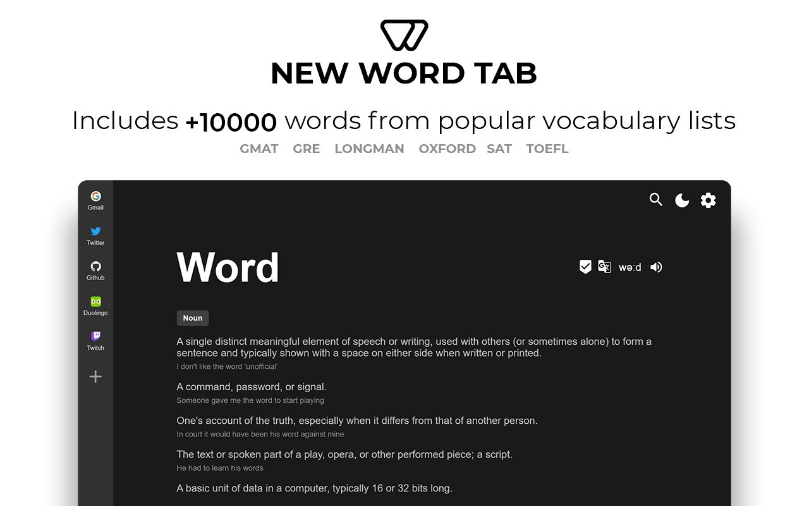

# LingoTab

> Учите английский язык каждый раз, когда открываете новую вкладку.

## Installation

- [**Chrome Web Store**](https://chrome.google.com/webstore/detail/new-word-tab/chmiakanncpjleocgbemoghkkpjicjla)

- [**Firefox Add-ons**](https://addons.mozilla.org/en-US/firefox/addon/new-word-tab/)

---

LingoTab — это расширение для браузера Firefox, превращающее стандартную страницу новой вкладки в мощный инструмент для изучения английского языка.

С каждым открытием новой вкладки вы видите случайное слово, его значение, перевод, примеры использования. Расширение позволяет вам взаимодействовать со словами для повышения уровня запоминания, а также дает вам возможность учить грамматику с помощью ии-функционала, который генерирует кастомные предложения для развития навыков контекстного использования ранее изученых слов.

---

## Основные функции

- **🗣 Произношение** — слушайте правильное произношение изучаемых слов.
- **📚 Значения и примеры** — узнавайте точные определения и реальный контекст использования.
- **🌍 Переводы через Google Translate** — переводите слова прямо в новой вкладке.
- **✅ Списки избранного** — сохраняйте слова для последующего изучения и повторения.
- **🔍 Поиск новых слов** — добавляйте интересующие слова в словарь за пару кликов.
- **📂 Импорт и экспорт слов** — управляйте словарём, сохраняя свои данные и прогресс.
- **🔄 Режим повторения** — тренировочные сессии для возвращения к уже изученным словам.
- **📘 Списки слов** — включает более 10,000 слов из авторитетных учебных программ: GMAT, GRE, Longman, Oxford, SAT, TOEFL.
- **🕒 История** — просматривайте недавно показанные слова, даже если вкладка была закрыта.
- **🎨 Темы оформления** — выбирайте тёмную или светлую тему в зависимости от своих предпочтений.
- **🖼 Настраиваемый фон** — персонализируйте внешний вид новой вкладки.
- **🔗 Закладки** — сохраняйте доступ к любимым сайтам прямо с новой вкладки, сохраняя привычный функционал новой вкладки браузера.

---

## Smart Sentences

**Smart Sentences** — это ИИ-функция, которая помогает изучать грамматику английского языка, создавая примеры предложений на базе настроек пользователя. Вы сможете практиковаться с грамматическими конструкциями и развивать навыки контекстного использования английского языка.

### Возможности:

- **✍️ Генерация предложений:** алгоритм автоматически создаёт примеры с помощью API нейросети Groq. 
- **⚙️ Гибкие настройки:**
  - Частота показа предложений.
  - Выбор грамматического времени для изучения конкретных правил.
  - Активация подсказок для помощи в разборе предложений.
  - Настройка сложности и темы генерируемого контента.
- **💡 Грамматические подсказки:** интегрированная помощь для лучшего понимания правил использования слов в контексте.
- **⭐ Параллельное изучение:** комбинируйте изучение грамматики с запоминанием новых слов.

---

### Credits:

- Special thanks to [Free Dictionary API](https://github.com/meetDeveloper/freeDictionaryAPI) which powers word definitions lookup.
- Based on: [new-word-tab](https://github.com/sajadhsm/new-word-tab) by Sajad Hashemian.
