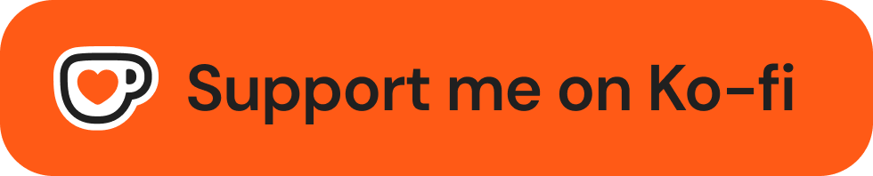

**Українська** · [Русский](README.ru.md) · [English](README.md)

# LingoTab

> Вивчайте англійську щоразу, коли відкриваєте нову вкладку.

https://github.com/user-attachments/assets/9efc3a13-02fd-41b1-bd3c-24e9c4789f09

---

LingoTab — це розширення для Chrome і Firefox, яке перетворює стандартну сторінку нової вкладки на потужний інструмент для вивчення англійської мови.

З кожним відкриттям нової вкладки ви бачите випадкове слово, його значення, переклад і приклади вживання. Розширення дозволяє взаємодіяти зі словами для кращого запам'ятовування, а також дає змогу тренувати граматику на готових реченнях — вбудованих або зібраних під себе, — розвиваючи навичку вживання вивчених слів у контексті.

---

### Встановлення

* **🦊 Firefox** — [LingoTab у каталозі додатків Firefox](https://addons.mozilla.org/firefox/addon/lingotab/)

---

### Основні функції

* **🗣 Вимова** — слухайте правильну вимову слів, які вивчаєте.
* **📚 Значення та приклади** — дізнавайтеся точні визначення й реальний контекст вживання.
* **📖 Джерело словника на вибір** — значення та вимова беруться з Wiktionary або Free Dictionary API. В автоматичному режимі розширення саме переходить на запасне джерело, якщо основне не відповідає.
* **🌍 Переклад слів** — переклад просто в новій вкладці, більш ніж на 100 мов. Якщо сервіс перекладу недоступний, підключається запасний, а вже відкриті слова продовжують показувати збережені переклади. Будь-який переклад можна замінити своїм — див. розділ «Власні переклади».
* **🙈 Прихований переклад** — режим самоперевірки: переклад ховається за кнопкою «Показати», щоб спершу згадати слово самостійно.
* **✅ Позначені слова** — зберігайте слова для подальшого вивчення та повторення.
* **🔍 Пошук нових слів** — додавайте цікаві вам слова до словника за пару кліків.
* **📂 Імпорт та експорт слів** — керуйте словником, зберігаючи свої дані та прогрес.
* **🔄 Режим повторення** — тренувальні сесії для повернення до вже вивчених слів.
* **📘 Списки слів** — понад 16 000 слів з авторитетних навчальних програм: GMAT, GRE, Longman, Oxford, SAT, TOEFL.
* **🕒 Історія** — переглядайте нещодавно показані слова, навіть якщо вкладку було закрито.
* **🌐 Мова інтерфейсу** — підписи самого розширення перекладені кількома мовами. За замовчуванням інтерфейс підлаштовується під мову, обрану для перекладу слів, але її можна задати і вручну.
* **🎨 Теми оформлення** — обирайте темну чи світлу тему на власний смак.
* **🖼 Налаштовуваний фон** — персоналізуйте вигляд нової вкладки.
* **🔗 Ярлики сайтів** — зберігайте доступ до улюблених сайтів просто з нової вкладки, не втрачаючи звичного функціоналу нової вкладки браузера.

---

### Власні переклади

Автоматичний переклад не завжди влучає в те значення, яке потрібне саме вам. Тепер будь-який переклад можна виправити та зберегти — ваш варіант завжди показується замість автоматичного.

**Це ж знімає обмеження на мову.** До словника можна додати слово будь-якою мовою — німецькою, польською, японською, — написати до нього свій переклад, і воно відкриватиметься нарівні з англійськими, навіть якщо англійський словник такого слова не знає. Так LingoTab перетворюється на інструмент для вивчення будь-якої мови, а не лише англійської.

#### Можливості:

* **✏️ Редагування перекладу** — олівець поруч зі словом на картці та у списку «Вивчаю». Ваш переклад завжди головніший за автоматичний.
* **➕ Додавання власних слів** — кнопка «Додати слово» внизу панелі позначених слів. Переклад можна написати самостійно або отримати автоматично одним натисканням.
* **📋 Переклади у списку «Вивчаю»** — переклад видно одразу поруч зі словом, а окремий режим сортування піднімає вгору слова з вашим перекладом.
* **📴 Робота без інтернету** — якщо сервіс перекладу недоступний або словник не знає слова, воно все одно відкриється на спрощеній картці з вашим перекладом.
* **🔁 Імпорт та експорт перекладів** — вивантажте слова разом з перекладами у файл JSON або завантажте готовий.
* **🤖 Переклади може зібрати ШІ** — у налаштуваннях, у розділі «Імпорт та експорт», лежить готовий промпт. Скопіюйте його, вставте в будь-який ШІ-чат, і він перекладе потрібні слова вашою мовою та поверне готовий файл JSON — залишиться завантажити його там само.

---

### Smart Sentences

**Smart Sentences** — це функція, яка допомагає вивчати граматику англійської мови на прикладах речень. Ви зможете практикуватися з граматичними конструкціями та розвивати навички вживання англійської в контексті.

#### Можливості:

* **📦 Вбудований набір речень** — готовий набір постачається разом із розширенням і перекладений 10 мовами. Потрібний варіант добирається автоматично за мовою, обраною в налаштуванні «Мова перекладу».
* **✍️ Власний набір речень** — кнопка «Copy prompt» копіює готовий запит для будь-якого ШІ-чату (ChatGPT, Claude та інших). Чат поставить кілька запитань і видасть файл, який залишиться імпортувати в розширення.
* **💡 Граматичні підказки** — до кожного речення можна увімкнути запитання з варіантами відповіді, де пояснюється, чому правильний саме цей варіант.
* **📗 Граматичний довідник** — під тренуванням розкривається картка того часу чи конструкції, що трапилася в реченні: пояснення, типові помилки та слова-маркери, за якими цей час упізнається.
* **⭐ Паралельне вивчення** — тренування речень можна чергувати зі звичайним вивченням слів і налаштовувати, як часто з'являється речення.

---

### Підтримати автора

Якщо розширення стало вам у пригоді, можливо, ви захочете підтримати мене. Я планую й далі його вдосконалювати, і ваша підтримка цьому суттєво посприяє. Дякую.

---

### Credits:

* Word definitions and pronunciation come from [Wiktionary](https://www.wiktionary.org/) (via the Wikimedia and Wiktionary APIs), with [Free Dictionary API](https://github.com/meetDeveloper/freeDictionaryAPI) as a fallback source.
* Based on: [new-word-tab](https://github.com/sajadhsm/new-word-tab) by Sajad Hashemian.
